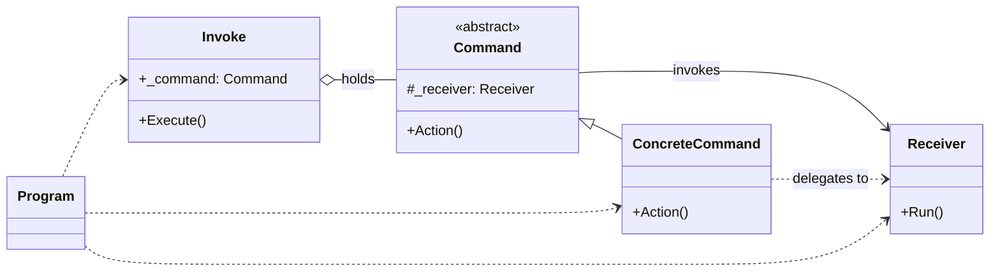

# 命令模式

将请求封装成一个对象，以便用不同的请求、队列、日志或撤销操作来参数化其他对象。
命令模式将发出请求的对象和执行请求的对象解耦：调用者只需要持有命令并执行它，不需要知道接收者如何完成具体工作。

在本示例中，`Invoke` 是调用者，`Command` 是抽象命令，`ConcreteCommand` 是具体命令，`Receiver` 是接收者，负责执行“跑1000米”的实际操作。

**优点：**

1. 将请求的发送者和接收者解耦，调用者不需要了解请求的具体执行过程。
2. 可以比较容易地增加新的命令，只需要添加新的具体命令类，符合开放——封闭原则。
3. 可以对命令进行组合、排队、记录日志，并且可以通过增加撤销逻辑支持撤销操作。

**缺点：**

1. 每增加一个请求，就可能需要增加一个具体命令类，导致系统中类的数量增多。
2. 如果命令之间没有明显区别，使用命令模式会增加系统的复杂度。

**应用场景：**

1. 需要将请求发送者和接收者解耦，或者需要让请求者不必知道请求的具体执行过程时。
2. 需要对请求进行排队、记录日志、持久化或延迟执行时，例如任务队列和事务日志。
3. 需要支持撤销和恢复操作，或者需要组合多个简单命令形成复杂操作时。

