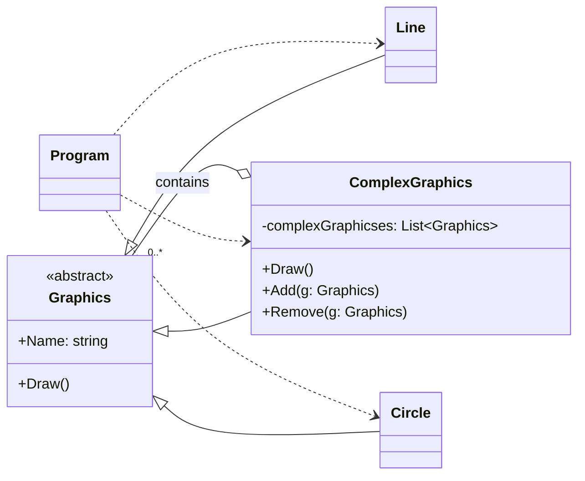

# 组合模式

通过一些简单图形以及一些复杂图形构建图形树来演示组合模式

**客户端调用：**

客户端只需要通过 `Graphics` 的多态性调用 `Draw()`，即可统一绘制单个图形和由多个图形组成的复杂图形。

**优点：**

1. 组合模式使得客户端代码可以一致地处理单个对象和对象容器，无需关心处理的是单个对象还是组合对象。
2. 将”客户代码与复杂的对象容器结构“解耦。
3. 可以更容易地往组合对象中加入新的构件。

**缺点：**

1. 使得设计更加复杂。客户端需要花更多时间理清类之间的层次关系。（这个是几乎所有设计模式所面临的问题）。

**注意的问题：**

1. 有时候系统需要遍历一个树枝结构的子构件很多次，这时候可以考虑把遍历子构件的结构存储在父构件里面作为缓存。
2. 客户端尽量不要直接依赖具体的树叶类，而应借助 `Graphics` 的多态性完成调用，这样可以降低耦合并增加代码复用性。

**在以下情况下应该考虑使用组合模式：**

1. 需要表示一个对象整体或部分的层次结构。
2. 希望用户忽略组合对象与单个对象的不同，用户将统一地使用组合结构中的所有对象。

