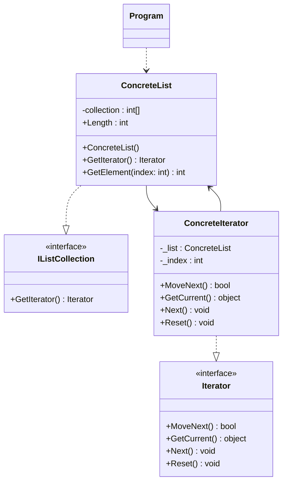

# 迭代器模式

迭代器模式提供了一种方法顺序访问一个聚合对象（理解为集合对象）中各个元素，而又无需暴露该对象的内部表示，这样既可以做到不暴露集合的内部结构，又可让外部代码透明地访问集合内部的数据。

**优点：**

1. 迭代器模式使得访问一个聚合对象的内容而无需暴露它的内部表示，即迭代抽象。
2. 迭代器模式为遍历不同的集合结构提供了一个统一的接口，从而支持同样的算法在不同的集合结构上进行操作

**缺点：**

1. 迭代器模式在遍历的同时修改集合结构可能导致异常，因此使用 `foreach` 遍历集合时，不应增删集合元素；如果只是修改元素自身的可变属性，通常是允许的。

**应用场景：**

1. 系统需要访问一个聚合对象的内容而无需暴露它的内部表示。
2. 系统需要支持对聚合对象的多种遍历。
3. 系统需要为不同的聚合结构提供一个统一的接口。

