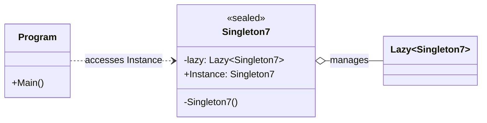

# 单例模式

单例模式确保一个类在应用程序中只有一个实例，并为该实例提供一个全局访问点。
实现单例模式通常需要将构造函数设为私有，避免客户端直接创建对象，同时通过静态成员返回唯一实例。

本工程通过 `Singleton1` 到 `Singleton7` 演示了 C# 中常见的单例实现方式，包含线程安全、延迟加载和性能等方面的不同取舍。`Program` 当前使用基于 `Lazy<T>` 的 `Singleton7`。

## 工程中的实现

| 类型 | 实现方式 | 特点 |
| --- | --- | --- |
| `Singleton1` | 简单懒加载 | 代码简单，但不保证多线程安全 |
| `Singleton2` | 每次访问加锁 | 线程安全，但每次获取实例都有加锁开销 |
| `Singleton3` | 双重检查加锁 | 减少不必要的加锁，代码相对复杂 |
| `Singleton4` | 静态字段初始化 | 线程安全，但实例会较早创建 |
| `Singleton5` | 私有嵌套类 | 线程安全且支持按需创建 |
| `Singleton6` | `static readonly` 字段 | 线程安全，直接初始化，适合无需延迟加载的场景 |
| `Singleton7` | `Lazy<T>` | 线程安全、按需创建，代码简洁，当前示例采用此方式 |

**优点：**

1. 确保系统中只有一个实例，避免重复创建对象造成的资源浪费。
2. 为该实例提供统一的访问入口，方便多个对象共享状态或服务。
3. 可以控制实例的创建过程，例如实现延迟加载和线程安全初始化。

**缺点：**

1. 单例对象通常拥有全局状态，会增加代码之间的耦合，降低可测试性。
2. 单例类同时承担实例管理和业务职责时，容易违反单一职责原则。
3. 在多线程环境下需要正确处理实例创建，否则可能产生多个实例或额外的同步开销。

**应用场景：**

1. 系统中确实只需要一个实例，并且该实例需要被多个对象共享时，例如配置管理器、日志管理器和缓存管理器。
2. 创建对象成本较高，或者对象需要统一协调访问某个共享资源时。
3. 需要集中管理数据库连接池、线程池等全局基础设施时。

使用单例模式前应确认对象确实不需要多个实例，并优先通过依赖注入传递依赖，避免不必要的全局状态。

